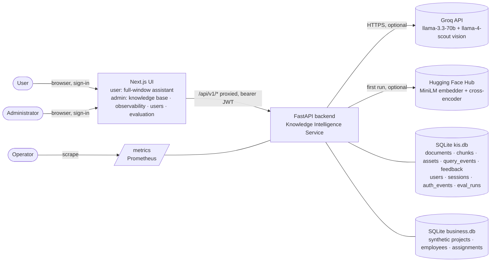
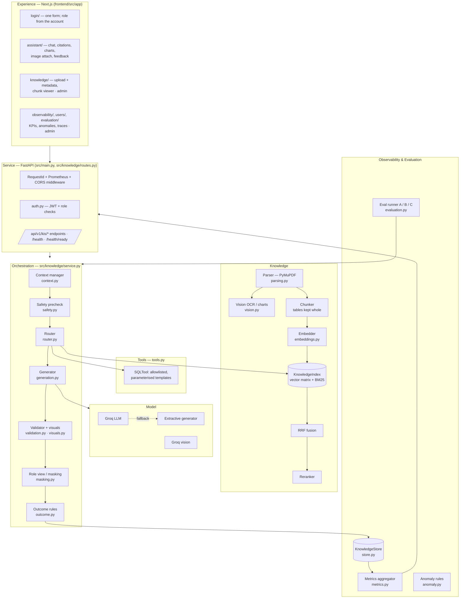
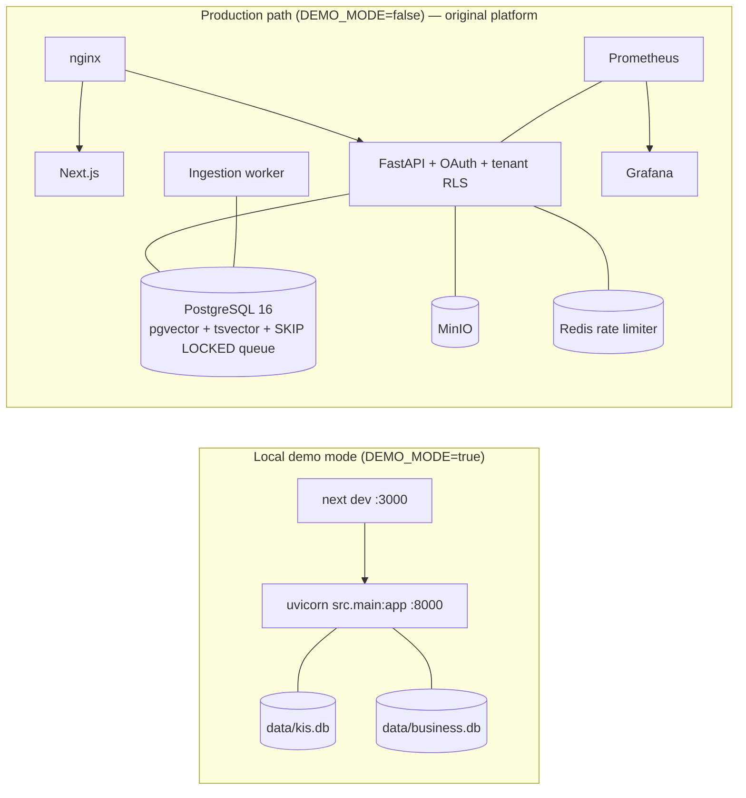

# High-Level Design: Enterprise Knowledge Intelligence Assistant

| | |
|---|---|
| **Project** | AI-Powered Enterprise Knowledge Intelligence Assistant (HCL Tech AI Engineer hackathon) |
| **Base codebase** | `ai_research_platform` (FastAPI + Next.js + PostgreSQL/pgvector), extended rather than rebuilt |
| **Sources** | Hackathon brief (*AI-Powered Enterprise Knowledge Intelligence Assistant*, §1–12), the team's hackathon execution plan (kept outside the repository), repository code as of 2026-10-27, including the merged improvement plan (auth and roles, vision OCR, masking, charts, budgets, per-user analytics, harder evaluation) |
| **Related docs** | [architecture.md](architecture.md) · [query_event_schema.md](query_event_schema.md) · [evaluation_report.md](../reports/evaluation_report.md) · [README.original.md](../README.original.md) |

---

## 1. Purpose and scope

This document describes the high-level design of the assistant. The assistant answers employee questions from approved documents and a structured business dataset. It returns grounded answers with verifiable citations and declines safely when evidence is missing, conflicting or malicious. It also records every query in an observability and evaluation dashboard, which the brief makes a mandatory differentiator.

The design covers two deployment modes that share one codebase:

| Mode | Switch | Purpose |
|---|---|---|
| **Local demo mode** (default) | `DEMO_MODE=true` | A self-contained vertical slice that covers the brief's full workflow. It needs only Python and Node: SQLite plus in-process indexes, with no PostgreSQL, MinIO, Redis or OAuth. |
| **Production path** | `DEMO_MODE=false` | The original multi-tenant platform: Google OAuth, PostgreSQL with RLS, pgvector + tsvector, MinIO and a worker queue. It is left unchanged. |

Most of this HLD describes demo mode, because that is where the hackathon requirements are implemented. Section 11 covers how the production path relates to it.

### 1.1 Design constraints

These constraints come from the team execution plan:

- **Four-hour build window.** Reuse and improve the existing code; do not rebuild it.
- **Keep the stack.** Do not add LangChain, a new vector database, Redis, another ORM or a new frontend framework.
- **No new external accounts** beyond what the repository already supported (Groq).
- **Honesty about what is real.** Any mock, simulation or fallback is labelled in the UI, the API and the README. Nothing simulated is shown as measured.
- **Synthetic data only**, and the demo must be repeatable offline.

### 1.2 Out of scope

These items come from brief §4.2: model training or fine-tuning, enterprise identity integration (demo mode has its own username/password accounts instead), real-time multi-source ingestion, confidential or regulated data, voice, and full computer-vision pipelines. Scanned pages, photos of handwriting and charts are read by a hosted vision model (Groq) when a key is configured; without one they are skipped with an explicit message.

---

## 2. System context



Both external dependencies are optional. Without `GROQ_API_KEY`, generation uses a deterministic extractive generator and vision features are skipped with a message. If the Hugging Face models cannot be loaded, the system falls back to a hashing embedder and a lexical reranker. The same build therefore runs fully offline. The active choice is recorded in every query event.

---

## 3. Logical architecture

The layers follow the reference architecture in brief §6.



### 3.1 Components

| Layer | Component | Module | Responsibility |
|---|---|---|---|
| Experience | Sign-in | `frontend/src/app/login`, `src/lib/auth.tsx` | One username/password form; the role comes from the account. Client guard redirects by role (the API is the real boundary). |
| | Assistant | `frontend/src/app/assistant` | Full-window chat for users. One plain status line per answer, citation chips with the cited sentence highlighted, tool rows as tables, charts, calculations, image attach, token limits, feedback. |
| | My history | `frontend/src/app/history` | A user's own sessions and turns (masked) and token use. |
| | Knowledge Base (admin) | `frontend/src/app/knowledge` | Drop zone, metadata fields, demo corpus, versions grouped, chunk viewer, vision tokens. |
| | Observability, Users, Evaluation (admin) | `frontend/src/app/observability`, `users`, `evaluation` | KPIs and charts, unusual activity, per-user filter, traces with the prompt sent; per-user sessions and transcripts; A/B/C runs with per-case results. |
| Service | API | `src/knowledge/routes.py` | Validated request/response contracts (Pydantic, `schemas.py`). Returns `X-Request-ID` as the correlation ID and uses the shared error envelope from `src/core/exceptions.py`. |
| | Middleware | `src/observability/middleware.py` | Request IDs and Prometheus HTTP metrics, reused from the base platform. |
| | Auth | `auth.py` | Login, bcrypt passwords, JWTs (from `src/core/security.py`), role per request from the database, 403 auth events. |
| Orchestration | Orchestrator | `service.py` | Runs the 12-step workflow (§4), times each stage, and builds and persists the query event. |
| | Context manager | `context.py` | Per-session memory of the last *N* = 3 turns. Rewrites follow-up questions and records which turns it selected. |
| | Router | `router.py` | Rule-based classifier that returns `docs`, `sql_tool` or `both`. The regex signals behind each decision are logged so the decision can be explained. |
| | Generator | `generation.py`, `calc.py` | Grounded prompt `kis-grounded-v2` at temperature 0; evidence, tool results and images as untrusted data; token budget; `{{calc: …}}` evaluated by a whitelist AST walker. Falls back to extractive generation. |
| | Validator | `validation.py`, `visuals.py` | Checks citation mapping and claim-level grounding (calc-aware), detects version conflicts, builds and checks charts. |
| | Role view | `masking.py` | Masks personal data and salaries in user-role responses; admins see raw. |
| | Outcome rules | `outcome.py` | Maps stage results to Success, Partial/Fallback or Failed with reason codes, flags and confidence. |
| Knowledge | Parser | `parsing.py`, `vision.py` | Intake validation (type, 20 MB, magic bytes, corrupt). PyMuPDF text and tables in reading order, DOCX in body order, TXT/MD; scanned pages, photos and charts via Groq vision, with page/chart images kept as assets. |
| | Chunker | `src/ingestion/pipeline.py` (reused) | Recursive splitting at 800 characters with 120 overlap, inside each page or section. A table is one chunk (split by rows with its header when long). |
| | Embedder / reranker | `embeddings.py` | `all-MiniLM-L6-v2` or a 384-dimensional hashing embedder. Cross-encoder `ms-marco-MiniLM-L-6-v2` or a lexical-coverage reranker. |
| | Index | `retrieval.py` | In-memory dense matrix plus a custom BM25 index (k1 = 1.5, b = 0.75). RRF uses the repository's own `_reciprocal_rank_fusion` with k = 60. Applies metadata filters and the evidence-sufficiency test. |
| Tools | SQL tool | `tools.py` | Five allowlisted templates over a read-only SQLite connection. Extracts parameters with strict patterns or allowlists. Records provenance. |
| Safety | Guards | `safety.py` | Detects query injection (blocks it) and strips injected instructions from documents and images (and logs them). |
| Observability | Store | `store.py` | SQLite tables `documents`, `chunks`, `assets`, `query_events` (JSON payload plus indexed user/token columns), `feedback`, `users`, `sessions`, `auth_events`, `eval_runs`. |
| | Metrics, anomalies | `metrics.py`, `anomaly.py` | §8.1 KPIs from stored events; per-user summaries; unusual-activity rules. |
| Evaluation | Runner | `evaluation.py`, `scripts/run_eval.py` | Runs the 40-case set through A, B and C as normal tagged queries, scores ranks and behaviour, saves the run and writes the report. |

---

## 4. Key flows

### 4.1 Ingestion (workflow steps 1–3)

```mermaid
sequenceDiagram
  participant UI as Knowledge Base UI
  participant API as POST /kis/ingest
  participant P as Parser
  participant S as KnowledgeService
  participant E as Embedder
  participant DB as kis.db
  participant IX as KnowledgeIndex
  UI->>API: multipart file
  API->>P: parse_document(name, bytes, max size)
  alt unsupported / too large / renamed executable / corrupt
    P-->>UI: 4xx with explicit reason
  end
  opt scanned page, photo or chart (vision configured)
    P->>P: render page / crop image -> Groq vision (OCR or chart JSON); keep image as asset
  end
  P-->>S: units (page or section) + metadata (Doc-ID, title, category, version, status, effective date)
  S->>DB: lookup SHA-256 content hash
  alt identical content already indexed
    S-->>UI: duplicate=true (no-op, repeatable indexing)
  end
  S->>S: chunk text (800/120), keep tables whole; prefix index text with<br/>"title (Doc-ID) version status | section"
  S->>E: encode(index_text[])
  S->>DB: insert document + chunks + embeddings
  S->>IX: rebuild vector matrix + BM25 from store
  S-->>UI: DocumentInfo (chunk count, metadata)
```

Design points:

- Text is chunked inside each page or section, so every chunk carries an exact page or section reference for citation.
- Each chunk's index text is prefixed with the document header. Version and status words ("superseded") and document IDs therefore become searchable terms.
- SQLite is the source of truth. The in-memory index is rebuilt from it at startup and after each change.

### 4.2 Query (workflow steps 4–11)

```mermaid
sequenceDiagram
  participant UI as Assistant UI
  participant API as POST /kis/query
  participant C as Context
  participant SF as Safety
  participant R as Router
  participant IX as Retrieval
  participant T as SQL tool
  participant G as Generator
  participant V as Validator
  participant O as Outcome
  participant ST as Event store
  UI->>API: {query, session_id, config_id A|B|C, filters, token limits} + bearer JWT
  API->>API: authenticate; session must belong to this user
  API->>SF: detect injection in the user's text
  SF->>C: resolve follow-up with last ≤3 turns (strict detection)
  alt injection in query
    SF-->>O: INJECTION_BLOCKED (retrieval, tool and LLM skipped)
  else
    SF->>R: route(normalized) → docs | sql_tool | both
    opt needs docs
      R->>IX: A: vector only · B: vector + BM25 → RRF → rerank
      IX-->>R: candidates, evidence_found (relevance ≥ 0.6), sanitized evidence S1..Sn
    end
    opt needs tool
      R->>T: plan template + extract params → execute read-only
      T-->>R: rows + provenance T1 (or error)
      Note over R,IX: if sql_tool-only and tool fails → retry via document retrieval
    end
    alt no evidence and no tool rows
      R-->>O: INSUFFICIENT_EVIDENCE (LLM not called)
    else
      R->>G: grounded prompt within the token budget (evidence, tool result, image as untrusted data)
      G-->>V: answer with [S#]/[T#]/[U1] tags, {{calc}} and optional chart (Groq, or extractive)
      V->>V: evaluate calcs → validate citations → grounding → conflicts → charts
      V->>V: build the role's view (mask PII and salaries for users)
      V->>O: stage results
    end
  end
  O->>ST: persist query event (all §8.2 categories)
  O-->>UI: answer, citations, outcome, confidence, query_id
  UI->>API: POST /kis/feedback {query_id, helpful, comment}
```

### 4.3 Evaluation (workflow step 12)

`POST /kis/eval/run` (or `scripts/run_eval.py`) replays `demo/eval/eval_set.json` (40 cases) through configurations **A, B and C**. Cases that need an LLM or vision are skipped and reported when those are not configured; user-role cases run as a synthetic user so masking is tested. Each case runs as an ordinary query tagged with `eval.run_id`, so every eval case can be drilled into on the dashboard like a user query. The runner scores expected behaviour, expected-document hits, hit@1, MRR@5, expected sections, must-include answer terms, grounding, citation validity (answered cases only), an optional LLM judge (model-graded), latency, tokens and cost. It saves the run in SQLite and writes `reports/evaluation_report.md`. Eval events are included in the dashboard KPIs by default. Set `include_eval=false` to see user traffic only.

---

## 5. Retrieval and grounding design

| Concern | Decision | Rationale |
|---|---|---|
| Dense retrieval | Cosine similarity over a normalised in-memory matrix | Demo-scale corpora fit in memory, and it needs no new infrastructure. |
| Sparse retrieval | Custom BM25 of about 40 lines. The tokenizer keeps hyphenated IDs (`ACR-3310`, `PRJ-1002`) as single tokens. | Exact IDs and acronyms are found even when semantic similarity is weak (FR-04). It adds no dependency. |
| Fusion | Reciprocal Rank Fusion, k = 60, reusing `src/retrieval/service.py` | The same algorithm as the production path, with no score calibration needed. |
| Reranking | Cross-encoder `ms-marco-MiniLM-L-6-v2`, with a documented lexical-coverage scorer as fallback | Meets FR-05 and still runs offline. |
| Evidence sufficiency | Relevance is the maximum of IDF-weighted query-term coverage (from 30 chunks up), cross-encoder probability and cosine similarity (semantic embedder only). It is compared with `KIS_MIN_EVIDENCE_SCORE` = 0.6. | Below the threshold, the LLM is **not called**, so the assistant cannot hallucinate on empty evidence (FR-10). |
| Metadata filters | `category`, `status`, `doc_id` and `version` on the query request | Meets the brief §4.1 metadata-filter requirement. |
| Ablation | Config C = hybrid without the reranker | Shows what the reranker adds for its latency cost. |
| Conflicts | Relevant evidence from different versions of the same Doc-ID is surfaced in the answer and the trace (`CONFLICT_SURFACED`) | Meets FR-09: show disagreements rather than hide them. |
| Citation validation | Each `[S#]`/`[T#]` tag must map to returned evidence or to a *successful* tool call | Meets brief §8.1 "citation support". |
| Grounding | A sentence is supported if it cites a valid source (or a later tag in its paragraph covers it), at least 50% of its content tokens appear in the cited sources, and every number it states appears there, is a calc result from cited operands, or was given in the question. The score is supported sentences ÷ all sentences, compared with a threshold of 0.7. | Deterministic and explainable. Its limits are listed in §12. |

---

## 6. Tool calling design

| Template | Purpose | Parameter source |
|---|---|---|
| `project_budget` | Budget, spend and remaining for one project | `PRJ-\d{4}` pattern |
| `project_headcount` | Number of people assigned to a project | `PRJ-\d{4}` pattern |
| `department_spend` | Aggregate budget and spend per department | Allowlist loaded from `projects.department` |
| `list_projects` | All projects | none |
| `vendor_invoices` | **Deliberately broken.** The table does not exist, which demonstrates the tool-failure path. The UI labels it "simulated failure". | `PRJ-\d{4}` pattern |

Controls:

- User text **never** becomes SQL. Only templates on the allowlist run, with bound parameters, on a read-only connection.
- Each call records its template, sanitized parameters, status, row count, latency and a result summary. Answers cite these as `[T1]`.
- If a tool failure leaves a docs-only answer, the outcome is `TOOL_FAILED_PARTIAL`. If no answer is possible, it is `Failed / TOOL_FAILED`. Users see a plain error; the raw driver error stays in the event.
- Parameters come from project **IDs** only. Questions that name a project ("Project Atlas") do not reach SQL; the team kept the tool unchanged, and the gap is an eval case.

---

## 7. Safety and security design

| Threat / requirement | Control | Where |
|---|---|---|
| Prompt injection in the question | Pattern detection. The query is blocked before retrieval with a fixed refusal (`INJECTION_BLOCKED`). | `safety.py`, `service.py` |
| Prompt injection inside documents | Instruction-like sentences are stripped from evidence before prompting, and the chunk is still used as data. Each removal is logged (`EMBEDDED_INJECTION_REMOVED`). | `safety.py` |
| Model treating evidence as instructions | The system prompt marks `<evidence>` and `<tool_result>` blocks as untrusted data and requires a source tag on every sentence. | `generation.py` |
| SQL injection | Allowlisted parameterised templates on a read-only connection | `tools.py` |
| Personal data and salaries | Masked in user-role responses (answer, evidence, tool rows, history); admins see raw; scores are computed before masking (`PII_MASKED`) | `masking.py` |
| Malformed or hostile uploads | Extension allowlist, 20 MB limit, magic bytes (renamed executables rejected), corrupt files | `parsing.py` |
| Instructions hidden in images | Image descriptions are sanitized like documents before use | `service.py`, `safety.py` |
| Leaking internals in errors | Stored errors keep only the exception class and a truncated message, with project paths replaced by `<app>` | `service.py::_sanitize_error` |
| Secrets | Read from `.env` through the existing `Settings` system. Never hard-coded or committed. | `src/core/config.py` |
| Authentication and roles | Username/password (bcrypt) and JWT; role read from the database per request; admin-only routes return 403 and log a `forbidden` event; same error for unknown user and wrong password; no API returns a password field; random JWT secret if the placeholder is left | `auth.py`, `routes.py` |
| Cross-user access | A session belongs to one user (403 on reuse); feedback only on own answers; history only own; assets confined to the data directory | `service.py`, `routes.py` |
| Abuse detection | Bursts, injection attempts, PII fishing, failed logins, 403s, token spikes, off-hours use | `anomaly.py` |
| Production path | `DEMO_MODE=false` mounts the original OAuth-protected, tenant-isolated routers, unchanged | `src/main.py` |

---

## 8. Observability design

### 8.1 Query event

Each query writes exactly one event to `query_events`. The indexed columns are `query_id`, `ts`, `session_id`, `config_id`, `outcome`, `total_ms`, `eval_run_id`, `user_id`, `username`, `role` and token/cost totals. The JSON payload covers every brief §8.2 category (identity, question and router decision, stage status, outcome, retrieval scores, evidence quality, context, tool calls, generation, citations, grounding, safety, performance, usage, feedback, errors) plus the prompt sent, calculations, visuals, masking, image input and token budget. The full field list is in [query_event_schema.md](query_event_schema.md).

### 8.2 Outcome model

**HTTP 200 does not imply Success.** Execution status and quality outcome are recorded separately. The rules are applied in order:

| Outcome | Reason codes |
|---|---|
| **Failed** | `STAGE_ERROR`, `TOOL_FAILED` |
| **Partial / Fallback** | `INJECTION_BLOCKED`, `INSUFFICIENT_EVIDENCE`, `TOOL_FAILED_PARTIAL`, `LLM_FALLBACK`, `NO_CITATIONS`, `INVALID_CITATIONS`, `UNSUPPORTED_CLAIMS`, `OUTPUT_TRUNCATED` |
| **Success** | `OK`: evidence found, all citations valid, grounding ≥ 0.7, no failed stage |

Some flags do not change the outcome: `CONFLICT_SURFACED`, `EMBEDDED_INJECTION_REMOVED`, `PII_MASKED`, `EVIDENCE_TRIMMED_FOR_BUDGET` and `CHART_REJECTED`. Confidence is high, medium or low, derived from the outcome, grounding and top relevance.

### 8.3 Dashboard KPIs

`GET /kis/metrics` computes every brief §8.1 KPI from stored events. It supports filters for configuration, outcome, time window, user and whether to include eval runs; it also reports measured retrieval (hit rate, MRR) from eval cases. The KPIs are total queries; outcome counts and rates with reason-code histograms; retrieval success; grounding rate; citation support; tool success; safety events; p50/p95 latency for retrieval, tool, LLM and total; tokens and estimated cost; and helpful/not-helpful feedback.

Cost is an **estimate** from the configured per-1K-token prices, and the dashboard labels it as one. Operational HTTP metrics are also exposed separately at `/metrics` for Prometheus. The original Grafana provisioning is under `docker/grafana`.

---

## 9. Interfaces

All endpoints are under `/api/v1`. Swagger is at `/docs`.

| Method | Path | Who | Purpose |
|---|---|---|---|
| GET | `/health`, `/health/ready` | public | Liveness; readiness (store, business DB, models) |
| POST / GET | `/kis/auth/login`, `/kis/auth/me` | public / any | Sign in; current user |
| GET | `/kis/config` | any | Active pipeline, vision and limits |
| POST | `/kis/query`, `/kis/query/multimodal` | any | Ask (A/B/C, filters, token limits); ask about an attached image |
| POST | `/kis/feedback` | any | Rate one of your own answers |
| GET | `/kis/assets/{id}`, `/kis/my/sessions`, `/kis/my/history` | any | Citation images; own history |
| POST / GET / DELETE | `/kis/ingest`, `/kis/ingest/demo`, `/kis/documents[/{id}][/chunks]` | admin | Knowledge base |
| GET | `/kis/metrics`, `/kis/queries[/{id}]` | admin | KPIs and traces |
| GET / POST | `/kis/admin/users[/summary]`, `/kis/admin/users/{id}/sessions`, `/kis/admin/sessions/{id}`, `/kis/admin/anomalies` | admin | Users, activity, transcripts, unusual activity |
| POST / GET | `/kis/eval/run`, `/kis/eval/status` | admin | Run the evaluation; last result (persisted) |

The frontend calls relative `/api/v1/*` paths, and Next.js rewrites them to `BACKEND_URL` (default `http://127.0.0.1:8000`).

---

## 10. Data design

| Store | Tables | Notes |
|---|---|---|
| `data/kis.db` | `documents` (metadata, hash, uploader, vision tokens), `chunks` (page, section, content type, source method, asset, embedding), `assets`, `query_events`, `feedback`, `users`, `sessions`, `auth_events`, `eval_runs` | A single SQLite connection with a lock; new columns are added on start-up. Deleting a document cascades to its chunks and assets. |
| `data/assets/` | Page renders, chart crops and uploaded photos (PNG) | Served only through `/kis/assets/{id}` to signed-in users. |
| `data/business.db` | `projects`, `employees`, `assignments` | Built from `demo/business_seed.sql` by `scripts/build_demo.py`. Synthetic data for a fictional company. |
| In memory | Dense matrix, BM25 postings, conversation memory | Rebuilt from `kis.db` at startup. Conversation memory is per process. |
| `demo/` | 19-document corpus (PDF with tables and a chart, DOCX, MD, TXT; three versions of one policy; near-duplicate IDs), samples (scan, handwriting photo, corrupt file), 40-case eval set | All synthetic ("Orion Synthetic Industries"), generated by `scripts/build_demo.py`. |

---

## 11. Deployment view



- **Demo:** two processes and two SQLite files. The setup steps are `build_demo.py`, then `seed_demo.py`, then `uvicorn` and `npm run dev` (see README).
- **Containers:** `docker-compose.demo.yml` runs the backend (`docker/Dockerfile.demo`, seeded on start-up into a `/data` volume) and the frontend (`docker/Dockerfile.frontend`, `BACKEND_URL` as a build argument). They have **not been built or tested** (Docker was unavailable on the development machine).
- **Production path:** `docker/docker-compose.yml` and `docker-compose.prod.yml` from the original platform. The demo work did not change it.

### 11.1 Graceful degradation

| Missing dependency | Behaviour | How it is reported |
|---|---|---|
| `GROQ_API_KEY`, or a Groq error | Extractive generator, with citations | `Partial / LLM_FALLBACK`; `generation.provider = extractive` |
| Vision (no key, disabled, error, or over `KIS_VISION_MAX_PAGES`) | Scanned pages and charts skipped; image uploads and image questions rejected with a reason; text layers still indexed | Upload response `skipped_pages` and `warnings`; 422 messages |
| sentence-transformers or model download | Hashing embedder and lexical reranker | `config_label`, `/kis/config` and the Knowledge Base page |
| SQL tool failure | Falls back to documents for SQL-only questions | `TOOL_FAILED_PARTIAL` or `TOOL_FAILED`; failed stage logged |
| Empty index | Honest insufficient-evidence answer | `stages.retrieval = empty_index` |
| Pipeline exception | Controlled error message; the event is still written | `Failed / STAGE_ERROR` with a sanitized error and correlation ID |

---

## 12. Configuration experiment (brief §10)

| | Config A | Config B | Config C (ablation) |
|---|---|---|---|
| Pipeline | Vector retrieval → LLM | Vector + BM25 → RRF → rerank → LLM | Vector + BM25 → RRF → LLM |

All three are compared over the same 40-case set: direct facts, exact IDs and acronyms next to near-duplicate distractors, paraphrases, facts inside tables, similar policies, multi-turn follow-ups (including the context-leak regression), structured data, combined questions, insufficient evidence, conflicts (including a draft version), injection in documents and questions, tool failure, user-role masking, charts, and LLM/vision cases (skipped without those capabilities).

**Latest committed run** (`reports/evaluation_report.md`: MiniLM embedder and cross-encoder, **no LLM**, 37 cases run, 3 skipped):

| Metric | A | B | C |
|---|---|---|---|
| Hit@1 | 0.85 | **0.93** | 0.89 |
| MRR@5 | 0.89 | **0.93** | 0.91 |
| Behaviour pass | 0.92 | 0.92 | 0.92 |
| Answer criteria | 0.86 | 0.82 | 0.86 |
| Median latency | 24 ms | 344 ms | 24 ms |

B ranks the expected document first more often, and C shows that fusion alone gets part of the way. B costs about 320 ms per query (cross-encoder on CPU), and one combined case lost an answer term because the extractive generator picked another sentence after reranking. The automatic recommendation is therefore "undecided". All configurations miss the two paraphrase cases (the 0.6 evidence threshold is strict for paraphrases) and the by-name SQL case. Success is 0% in this run because the extractive generator always reports `LLM_FALLBACK`; a run with `GROQ_API_KEY` is still needed before choosing.

---

## 13. Key design decisions

| # | Decision | Alternatives considered | Rationale |
|---|---|---|---|
| D1 | Add a `DEMO_MODE` vertical slice next to the untouched production path | Making the PostgreSQL/MinIO/OAuth stack demo-ready | Fits the four-hour window, runs offline and predictably, and keeps production security intact. |
| D2 | SQLite plus in-memory indexes | pgvector, ChromaDB, FAISS | No new infrastructure. The execution plan forbids a new vector database. Demo scale is small. |
| D3 | Custom BM25 and reuse of the repository's RRF and chunker | rank-bm25, OpenSearch | No new dependency, and consistent with the production algorithms. |
| D4 | Rule-based router and grounding | An LLM-based classifier or judge | Deterministic, testable offline, cheap, and explainable in the trace. |
| D5 | Groq `llama-3.3-70b-versatile` (configurable) with an extractive fallback | Azure OpenAI; the 8B model | Groq was already integrated and needs no new account. The larger model follows citation and calc rules more reliably. The fallback keeps the demo working without a key. |
| D6 | Allowlisted SQL templates rather than text-to-SQL | LLM-generated SQL | Eliminates SQL injection by construction and keeps provenance exact. |
| D7 | One JSON event per query, plus indexed columns | OpenTelemetry traces, a separate table per stage | Covers all §8.2 categories in one record. The schema can change without migrations, and the dashboard reads it directly. |
| D8 | Skip the LLM when evidence is below threshold | Always generate and let the model decline | Guarantees no answer is generated without evidence, and saves cost. |
| D9 | No framework (LangChain or LlamaIndex) | The brief's suggested options | The execution plan forbids LangChain, and the pipeline is small enough to stay transparent in plain Python. |
| D10 | Username/password + JWT with two roles; role read from the DB per request | Trusting a role claim in the token; frontend-only hiding | Server-side enforcement; deactivation applies immediately; the UI is never the security boundary. |
| D11 | Groq vision for OCR and charts, PyMuPDF for parsing | Tesseract / RapidOCR offline; pypdf + pypdfium2 | One key, handles handwriting, reads charts into data tables; PyMuPDF gives text, tables, rendering and images in one library. Trade-off: no OCR offline. |
| D12 | Charts embedded as text summaries + data tables | Image embeddings (CLIP) | Text works with BM25, the reranker and citation checks; CLIP captures appearance, not numbers. The original image is still shown. |
| D13 | Mask personal data in the response for users only | Masking at ingestion | Admins keep full access, scores are identical for both roles, and the raw event remains auditable. |
| D14 | `{{calc}}` evaluated by a whitelist AST walker | Letting the model do arithmetic; `eval` | Sums are exact and auditable, and no code can run. |
| D15 | Tables and the SQL tool kept as they were (team decision) | Storing document tables in SQL; LLM tool calling | Simpler and safer within the time box; leaves the by-name SQL gap (§14). |

---

## 14. Limitations, risks and next steps

| Area | Limitation / risk | Next step |
|---|---|---|
| Live LLM and vision | Not run against the live Groq API on the dev machine (no key); covered by tests with a stubbed LLM and a fake vision client | Run the demo questions and the eval with a key; confirm both model IDs are still served |
| OCR offline | Without a key, scanned pages and photos cannot be read | Optional offline OCR (e.g. RapidOCR) behind the same interface |
| SQL by name | Only project IDs reach the SQL tool | LLM tool selection with allowlist validation and name-to-ID lookup |
| Routing / grounding | Regex and token-overlap rules miss paraphrases; two paraphrase eval cases fall below the evidence threshold | Calibrate the threshold on the semantic run; add an LLM or NLI check, logged next to the rule decision |
| Masking | Pattern-based; person names are not masked | NER-based masking if names must be hidden |
| Token storage | JWT in `localStorage` (as the existing client did) | httpOnly cookie |
| Scale | The index is held in memory and rebuilt on each ingest; one SQLite writer | Switch demo mode to the production pgvector/tsvector store and worker queue |
| State | Conversation memory and eval jobs live in one process | Persist sessions' turns; move eval jobs to the job queue |
| Containers | `docker-compose.demo.yml` is untested | Build and smoke-test it in CI |
| Cost | Cost is estimated from configured prices | Read provider usage and billing data where available |
