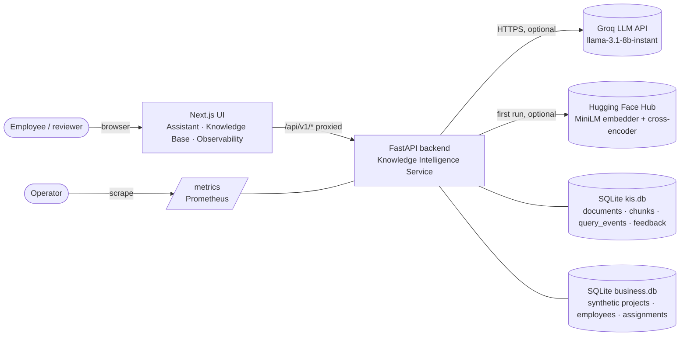
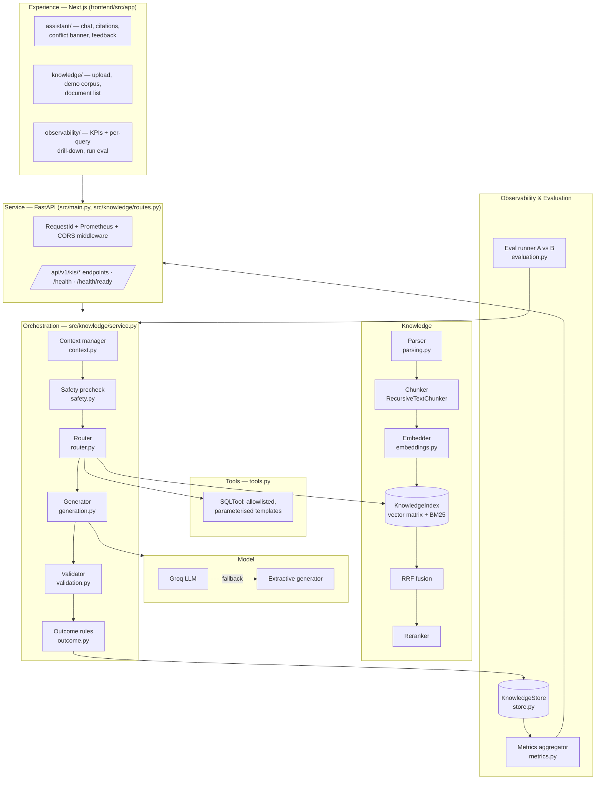
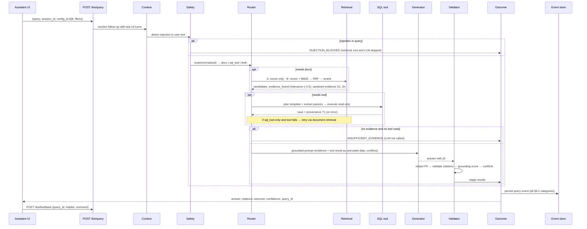
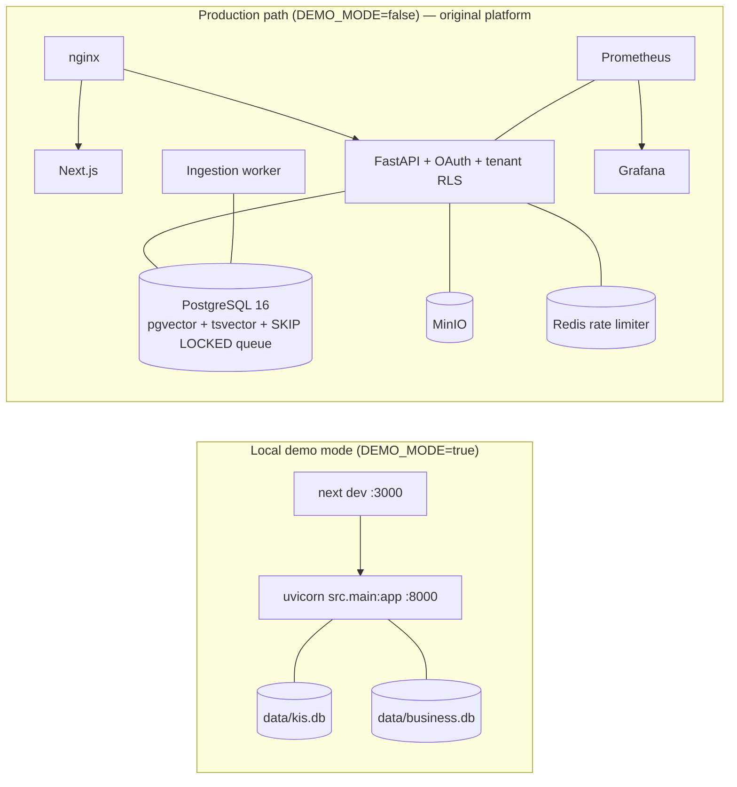

# High-Level Design: Enterprise Knowledge Intelligence Assistant

| | |
|---|---|
| **Project** | AI-Powered Enterprise Knowledge Intelligence Assistant (HCL Tech AI Engineer hackathon) |
| **Base codebase** | `ai_research_platform` (FastAPI + Next.js + PostgreSQL/pgvector), extended rather than rebuilt |
| **Sources** | Hackathon brief (*AI-Powered Enterprise Knowledge Intelligence Assistant*, §1–12), team execution plan (`CLAUDE.md`), repository code as of 2026-10-27 |
| **Related docs** | [architecture.md](architecture.md) · [query_event_schema.md](query_event_schema.md) · [evaluation_report.md](../reports/evaluation_report.md) · [README.original.md](../README.original.md) |

---

## 1. Purpose and scope

This document describes the high-level design of the assistant. The assistant answers employee questions from approved documents and a structured business dataset. It returns grounded answers with verifiable citations and declines safely when evidence is missing, conflicting or malicious. It also records every query in an observability and evaluation dashboard, which the brief makes a mandatory differentiator.

The design covers two deployment modes that share one codebase:

| Mode | Switch | Purpose |
|---|---|---|
| **Local demo mode** (default) | `DEMO_MODE=true` | A self-contained vertical slice that covers the brief's full workflow. It needs only Python and Node: SQLite plus in-process indexes, with no PostgreSQL, MinIO, Redis or OAuth. |
| **Production path** | `DEMO_MODE=false` | The original multi-tenant platform: Google OAuth, PostgreSQL with RLS, pgvector + tsvector, MinIO and a worker queue. It is left unchanged. |

Most of this HLD describes demo mode, because that is where the hackathon requirements are implemented. Section 11 covers how the production path relates to it.

### 1.1 Design constraints

These constraints come from the team execution plan:

- **Four-hour build window.** Reuse and improve the existing code; do not rebuild it.
- **Keep the stack.** Do not add LangChain, a new vector database, Redis, another ORM or a new frontend framework.
- **No new external accounts** beyond what the repository already supported (Groq).
- **Honesty about what is real.** Any mock, simulation or fallback is labelled in the UI, the API and the README. Nothing simulated is shown as measured.
- **Synthetic data only**, and the demo must be repeatable offline.

### 1.2 Out of scope

These items come from brief §4.2: model training or fine-tuning, enterprise identity integration, real-time multi-source ingestion, confidential or regulated data, voice, and full computer-vision pipelines. **OCR** for scanned or handwritten documents is also not implemented. Such files are detected and rejected with an explicit message (see §12).

---

## 2. System context



Both external dependencies are optional. Without `GROQ_API_KEY`, generation uses a deterministic extractive generator. If the Hugging Face models cannot be loaded, the system falls back to a hashing embedder and a lexical reranker. The same build therefore runs fully offline. The active choice is recorded in every query event.

---

## 3. Logical architecture

The layers follow the reference architecture in brief §6.



### 3.1 Components

| Layer | Component | Module | Responsibility |
|---|---|---|---|
| Experience | Assistant | `frontend/src/app/assistant` | Chat with session continuity. Renders `[S#]`/`[T#]` citation chips, the conflict banner, outcome/confidence badges and 👍/👎 feedback. |
| | Knowledge Base | `frontend/src/app/knowledge` | Upload, "Load demo corpus", document list and delete. Shows the active embedder and reranker. |
| | Observability | `frontend/src/app/observability`, `[id]` | KPI tiles, outcome and reason-code distributions, a recent-queries table, a full trace per query, and an evaluation-run trigger. |
| Service | API | `src/knowledge/routes.py` | Validated request/response contracts (Pydantic, `schemas.py`). Returns `X-Request-ID` as the correlation ID and uses the shared error envelope from `src/core/exceptions.py`. |
| | Middleware | `src/observability/middleware.py` | Request IDs and Prometheus HTTP metrics, reused from the base platform. |
| Orchestration | Orchestrator | `service.py` | Runs the 12-step workflow (§4), times each stage, and builds and persists the query event. |
| | Context manager | `context.py` | Per-session memory of the last *N* = 3 turns. Rewrites follow-up questions and records which turns it selected. |
| | Router | `router.py` | Rule-based classifier that returns `docs`, `sql_tool` or `both`. The regex signals behind each decision are logged so the decision can be explained. |
| | Generator | `generation.py` | Grounded prompt template `kis-grounded-v1` at temperature 0. Evidence and tool results are passed as untrusted data blocks. Falls back to extractive generation. |
| | Validator | `validation.py` | Checks citation mapping and claim-level grounding, and detects version conflicts. |
| | Outcome rules | `outcome.py` | Maps stage results to Success, Partial/Fallback or Failed with reason codes, flags and confidence. |
| Knowledge | Parser | `parsing.py` | Intake validation (type, size, empty, corrupt, no text layer). Extracts PDF text per page, DOCX headings and tables, and TXT/MD sections, plus document metadata. |
| | Chunker | `src/ingestion/pipeline.py` (reused) | Recursive splitting at 800 characters with 120 overlap, inside each page or section. |
| | Embedder / reranker | `embeddings.py` | `all-MiniLM-L6-v2` or a 384-dimensional hashing embedder. Cross-encoder `ms-marco-MiniLM-L-6-v2` or a lexical-coverage reranker. |
| | Index | `retrieval.py` | In-memory dense matrix plus a custom BM25 index (k1 = 1.5, b = 0.75). RRF uses the repository's own `_reciprocal_rank_fusion` with k = 60. Applies metadata filters and the evidence-sufficiency test. |
| Tools | SQL tool | `tools.py` | Five allowlisted templates over a read-only SQLite connection. Extracts parameters with strict patterns or allowlists. Records provenance. |
| Safety | Guards | `safety.py` | Detects query injection (blocks it), strips injected instructions from evidence (and logs them), and redacts PII from output. |
| Observability | Store | `store.py` | SQLite tables `documents`, `chunks`, `query_events` (JSON payload plus indexed columns) and `feedback`. |
| | Metrics | `metrics.py` | Computes the brief §8.1 KPIs from stored events only, with filters. |
| Evaluation | Runner | `evaluation.py`, `scripts/run_eval.py` | Runs the 16-case set through configurations A and B as normal tagged queries and writes the comparison report. |

---

## 4. Key flows

### 4.1 Ingestion (workflow steps 1–3)

```mermaid
sequenceDiagram
  participant UI as Knowledge Base UI
  participant API as POST /kis/ingest
  participant P as Parser
  participant S as KnowledgeService
  participant E as Embedder
  participant DB as kis.db
  participant IX as KnowledgeIndex
  UI->>API: multipart file
  API->>P: parse_document(name, bytes, max size)
  alt unsupported / too large / empty / corrupt / no text layer
    P-->>UI: 4xx with explicit reason (e.g. "OCR not enabled")
  end
  P-->>S: units (page or section) + metadata (Doc-ID, title, category, version, status, effective date)
  S->>DB: lookup SHA-256 content hash
  alt identical content already indexed
    S-->>UI: duplicate=true (no-op, repeatable indexing)
  end
  S->>S: chunk each unit (800/120); prefix index text with<br/>"title (Doc-ID) version status | section"
  S->>E: encode(index_text[])
  S->>DB: insert document + chunks + embeddings
  S->>IX: rebuild vector matrix + BM25 from store
  S-->>UI: DocumentInfo (chunk count, metadata)
```

Design points:

- Text is chunked inside each page or section, so every chunk carries an exact page or section reference for citation.
- Each chunk's index text is prefixed with the document header. Version and status words ("superseded") and document IDs therefore become searchable terms.
- SQLite is the source of truth. The in-memory index is rebuilt from it at startup and after each change.

### 4.2 Query (workflow steps 4–11)



### 4.3 Evaluation (workflow step 12)

`POST /kis/eval/run` (or `scripts/run_eval.py`) replays `demo/eval/eval_set.json` through **both** configurations. Each case runs as an ordinary query tagged with `eval.run_id`, so every eval case can be drilled into on the dashboard like a user query. The runner scores expected behaviour, expected-document hits, must-include answer terms, grounding, citation validity, latency, tokens and cost. It then writes `reports/evaluation_report.md`. Eval events are included in the dashboard KPIs by default. Set `include_eval=false` to see user traffic only.

---

## 5. Retrieval and grounding design

| Concern | Decision | Rationale |
|---|---|---|
| Dense retrieval | Cosine similarity over a normalised in-memory matrix | Demo-scale corpora fit in memory, and it needs no new infrastructure. |
| Sparse retrieval | Custom BM25 of about 40 lines. The tokenizer keeps hyphenated IDs (`ACR-3310`, `PRJ-1002`) as single tokens. | Exact IDs and acronyms are found even when semantic similarity is weak (FR-04). It adds no dependency. |
| Fusion | Reciprocal Rank Fusion, k = 60, reusing `src/retrieval/service.py` | The same algorithm as the production path, with no score calibration needed. |
| Reranking | Cross-encoder `ms-marco-MiniLM-L-6-v2`, with a documented lexical-coverage scorer as fallback | Meets FR-05 and still runs offline. |
| Evidence sufficiency | Relevance is the maximum of query-term coverage, cross-encoder probability and cosine similarity (semantic embedder only). It is compared with `KIS_MIN_EVIDENCE_SCORE` = 0.6. | Below the threshold, the LLM is **not called**, so the assistant cannot hallucinate on empty evidence (FR-10). |
| Metadata filters | `category` and `status` on the query request | Meets the brief §4.1 metadata-filter requirement. |
| Conflicts | Relevant evidence from different versions of the same Doc-ID is surfaced in the answer and the trace (`CONFLICT_SURFACED`) | Meets FR-09: show disagreements rather than hide them. |
| Citation validation | Each `[S#]`/`[T#]` tag must map to returned evidence or to a *successful* tool call | Meets brief §8.1 "citation support". |
| Grounding | A sentence is supported if it cites a valid source, at least 50% of its content tokens appear in the cited sources, and every number it states appears there. The score is supported sentences ÷ all sentences, compared with a threshold of 0.7. | Deterministic and explainable. Its limits are listed in §12. |

---

## 6. Tool calling design

| Template | Purpose | Parameter source |
|---|---|---|
| `project_budget` | Budget, spend and remaining for one project | `PRJ-\d{4}` pattern |
| `project_headcount` | Number of people assigned to a project | `PRJ-\d{4}` pattern |
| `department_spend` | Aggregate budget and spend per department | Allowlist loaded from `projects.department` |
| `list_projects` | All projects | none |
| `vendor_invoices` | **Deliberately broken.** The table does not exist, which demonstrates the tool-failure path. The UI labels it "simulated failure". | `PRJ-\d{4}` pattern |

Controls:

- User text **never** becomes SQL. Only templates on the allowlist run, with bound parameters, on a read-only connection.
- Each call records its template, sanitized parameters, status, row count, latency and a result summary. Answers cite these as `[T1]`.
- If a tool failure leaves a docs-only answer, the outcome is `TOOL_FAILED_PARTIAL`. If no answer is possible, it is `Failed / TOOL_FAILED`.

---

## 7. Safety and security design

| Threat / requirement | Control | Where |
|---|---|---|
| Prompt injection in the question | Pattern detection. The query is blocked before retrieval with a fixed refusal (`INJECTION_BLOCKED`). | `safety.py`, `service.py` |
| Prompt injection inside documents | Instruction-like sentences are stripped from evidence before prompting, and the chunk is still used as data. Each removal is logged (`EMBEDDED_INJECTION_REMOVED`). | `safety.py` |
| Model treating evidence as instructions | The system prompt marks `<evidence>` and `<tool_result>` blocks as untrusted data and requires a source tag on every sentence. | `generation.py` |
| SQL injection | Allowlisted parameterised templates on a read-only connection | `tools.py` |
| PII in output | Regex redaction of emails, phone numbers and ID or card numbers, with counts logged (`PII_REDACTED`) | `safety.py` |
| Malformed or hostile uploads | Checks for extension allowlist, size limit (`KIS_MAX_UPLOAD_MB`), empty or corrupt files and missing text layer | `parsing.py` |
| Leaking internals in errors | Stored errors keep only the exception class and a truncated message, with project paths replaced by `<app>` | `service.py::_sanitize_error` |
| Secrets | Read from `.env` through the existing `Settings` system. Never hard-coded or committed. | `src/core/config.py` |
| Authentication | Demo mode has **no auth** and says so in the header ("Local demo mode"). `DEMO_MODE=false` mounts the original OAuth-protected, tenant-isolated routers. Demo mode never weakens them. | `src/main.py` |

---

## 8. Observability design

### 8.1 Query event

Each `POST /kis/query` writes exactly one event to `query_events`. The indexed columns are `query_id`, `ts`, `session_id`, `config_id`, `outcome`, `total_ms` and `eval_run_id`. The JSON payload covers every brief §8.2 category: identity, question and router decision, stage status, outcome, retrieval scores, evidence quality, context turns, tool calls, generation, citations, grounding, safety, performance, usage, feedback and errors. The full field list is in [query_event_schema.md](query_event_schema.md).

### 8.2 Outcome model

**HTTP 200 does not imply Success.** Execution status and quality outcome are recorded separately. The rules are applied in order:

| Outcome | Reason codes |
|---|---|
| **Failed** | `STAGE_ERROR`, `TOOL_FAILED` |
| **Partial / Fallback** | `INJECTION_BLOCKED`, `INSUFFICIENT_EVIDENCE`, `TOOL_FAILED_PARTIAL`, `LLM_FALLBACK`, `NO_CITATIONS`, `INVALID_CITATIONS`, `UNSUPPORTED_CLAIMS` |
| **Success** | `OK`: evidence found, all citations valid, grounding ≥ 0.7, no failed stage |

Some flags do not change the outcome: `CONFLICT_SURFACED`, `EMBEDDED_INJECTION_REMOVED` and `PII_REDACTED`. Confidence is high, medium or low, derived from the outcome, grounding and top relevance.

### 8.3 Dashboard KPIs

`GET /kis/metrics` computes every brief §8.1 KPI from stored events. It supports filters for configuration, outcome, time window and whether to include eval runs. The KPIs are total queries; outcome counts and rates with reason-code histograms; retrieval success; grounding rate; citation support; tool success; safety events; p50/p95 latency for retrieval, tool, LLM and total; tokens and estimated cost; and helpful/not-helpful feedback.

Cost is an **estimate** from the configured per-1K-token prices, and the dashboard labels it as one. Operational HTTP metrics are also exposed separately at `/metrics` for Prometheus. The original Grafana provisioning is under `docker/grafana`.

---

## 9. Interfaces

All endpoints are under `/api/v1`. Swagger is at `/docs`.

| Method | Path | Purpose |
|---|---|---|
| GET | `/health`, `/health/ready` | Liveness check; readiness check covering the store, business DB and models |
| GET | `/kis/config` | Active embedder, reranker, LLM, thresholds and the A/B configuration labels |
| POST | `/kis/ingest` · `/kis/ingest/demo` | Upload and index one file · index `demo/corpus/*` |
| GET / DELETE | `/kis/documents[/{id}]` | List or remove documents |
| POST | `/kis/query` | `{query, session_id?, config_id: "A"\|"B", top_k?, category?, status?}` |
| POST | `/kis/feedback` | `{query_id, helpful, comment?}` |
| GET | `/kis/metrics` | Aggregate KPIs, with filters |
| GET | `/kis/queries[/{id}]` | Recent query summaries, or the full event for one query |
| POST / GET | `/kis/eval/run` · `/kis/eval/status` | Start the A/B evaluation in the background · poll its status |

The frontend calls relative `/api/v1/*` paths, and Next.js rewrites them to `BACKEND_URL` (default `http://127.0.0.1:8000`).

---

## 10. Data design

| Store | Tables | Notes |
|---|---|---|
| `data/kis.db` | `documents` (metadata, SHA-256 hash), `chunks` (page, section, content, index text, embedding as JSON), `query_events`, `feedback` | A single SQLite connection with a lock. Deleting a document cascades to its chunks. |
| `data/business.db` | `projects`, `employees`, `assignments` | Built from `demo/business_seed.sql` by `scripts/build_demo.py`. Synthetic data for a fictional company. |
| In memory | Dense matrix, BM25 postings, conversation memory | Rebuilt from `kis.db` at startup. Conversation memory is per process. |
| `demo/` | 6-document corpus (PDF, DOCX, MD, TXT, with v1/v2 of one policy), invalid samples, 16-case eval set | All synthetic ("Orion Synthetic Industries"). |

---

## 11. Deployment view



- **Demo:** two processes and two SQLite files. The setup steps are `build_demo.py`, then `seed_demo.py`, then `uvicorn` and `npm run dev` (see README).
- **Container:** `docker/Dockerfile.demo` packages the demo backend in a single container for cloud readiness. It has **not been built or tested** (Docker was unavailable on the development machine).
- **Production path:** `docker/docker-compose.yml` and `docker-compose.prod.yml` from the original platform. The demo work did not change it.

### 11.1 Graceful degradation

| Missing dependency | Behaviour | How it is reported |
|---|---|---|
| `GROQ_API_KEY`, or a Groq error | Extractive generator, with citations | `Partial / LLM_FALLBACK`; `generation.provider = extractive` |
| sentence-transformers or model download | Hashing embedder and lexical reranker | `config_label`, `/kis/config` and the Knowledge Base page |
| SQL tool failure | Falls back to documents for SQL-only questions | `TOOL_FAILED_PARTIAL` or `TOOL_FAILED`; failed stage logged |
| Empty index | Honest insufficient-evidence answer | `stages.retrieval = empty_index` |
| Pipeline exception | Controlled error message; the event is still written | `Failed / STAGE_ERROR` with a sanitized error and correlation ID |

---

## 12. Configuration experiment (brief §10)

| | Config A | Config B |
|---|---|---|
| Pipeline | Vector retrieval → LLM | Vector + BM25 → RRF → rerank → LLM |

Both configurations can be selected per query and are compared over the same 16-case set. The cases cover direct facts, exact IDs and acronyms, multi-turn follow-ups, structured data, combined questions, insufficient evidence, conflicts, injection in a document and in the question, tool failure, and regression.

**Latest committed run** (`reports/evaluation_report.md`, offline: hashing embedder, extractive generator):

- A and B scored the **same** on behaviour pass rate (1.0), retrieval hit rate (1.0), answer criteria (0.82) and valid citations (0.75).
- B added about 3 ms of median latency.
- No case reached `Success`, because the extractive generator always reports `LLM_FALLBACK`.

This run therefore **does not show** a quality benefit from hybrid retrieval. The small corpus and the coverage-based relevance signal leave little room for the two configurations to differ. B stays the default for its robustness on exact IDs (by design), but this needs confirmation in a rerun with the semantic embedder, the cross-encoder and Groq enabled, ideally on a larger and harder corpus.

---

## 13. Key design decisions

| # | Decision | Alternatives considered | Rationale |
|---|---|---|---|
| D1 | Add a `DEMO_MODE` vertical slice next to the untouched production path | Making the PostgreSQL/MinIO/OAuth stack demo-ready | Fits the four-hour window, runs offline and predictably, and keeps production security intact. |
| D2 | SQLite plus in-memory indexes | pgvector, ChromaDB, FAISS | No new infrastructure. The execution plan forbids a new vector database. Demo scale is small. |
| D3 | Custom BM25 and reuse of the repository's RRF and chunker | rank-bm25, OpenSearch | No new dependency, and consistent with the production algorithms. |
| D4 | Rule-based router and grounding | An LLM-based classifier or judge | Deterministic, testable offline, cheap, and explainable in the trace. |
| D5 | Groq Llama 3.1 8B with an extractive fallback | Azure OpenAI | Groq was already integrated and needs no new account. The fallback keeps the demo working without a key. |
| D6 | Allowlisted SQL templates rather than text-to-SQL | LLM-generated SQL | Eliminates SQL injection by construction and keeps provenance exact. |
| D7 | One JSON event per query, plus indexed columns | OpenTelemetry traces, a separate table per stage | Covers all §8.2 categories in one record. The schema can change without migrations, and the dashboard reads it directly. |
| D8 | Skip the LLM when evidence is below threshold | Always generate and let the model decline | Guarantees no answer is generated without evidence, and saves cost. |
| D9 | No framework (LangChain or LlamaIndex) | The brief's suggested options | The execution plan forbids LangChain, and the pipeline is small enough to stay transparent in plain Python. |

---

## 14. Limitations, risks and next steps

| Area | Limitation / risk | Next step |
|---|---|---|
| OCR | Scanned and handwritten documents are rejected, not processed | Add Tesseract or a hosted OCR stage behind the existing "no text layer" check |
| Routing / grounding | Regex and token-overlap rules miss paraphrases and can over-trigger | Add an LLM or NLI classifier, logged next to the rule decision |
| Scale | The index is held in memory and fully rebuilt on each ingest; there is one SQLite writer | Switch demo mode to the production pgvector/tsvector store and worker queue |
| State | Conversation memory and eval jobs live in one process | Persist sessions and move eval jobs to the production job queue |
| Auth | Demo mode has no authentication | Use `DEMO_MODE=false` for anything beyond a local demo |
| Evaluation | A vs B shows no difference offline (§12) | Rerun with semantic models and Groq; expand the corpus and adversarial cases |
| Container | `Dockerfile.demo` is untested | Build it and smoke-test it in CI |
| Cost | Cost is estimated from configured prices | Read provider usage and billing data where available |
