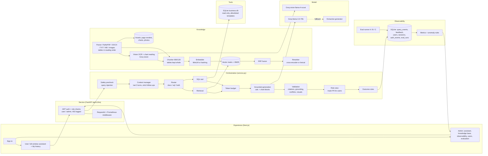

# Architecture & Design Decisions

## Overview

The production path from the original repository (PostgreSQL + pgvector + tsvector, MinIO, worker queue, Google OAuth, multi-tenant RLS) is untouched and runs when `DEMO_MODE=false`. Demo mode reuses its pieces: the app factory, config system, exception envelope, `security.py` (bcrypt, JWT), `RecursiveTextChunker`, `SentenceTransformerEmbedder`, `_reciprocal_rank_fusion`, structlog and the Prometheus middleware.

## Design decisions

### Access control
- **Two roles, enforced server-side.** `user` may only use the assistant, feedback on their own answers, their own history and assets. Everything else (ingest, documents, metrics, queries, evaluation, user management) requires `admin`. The UI hides admin pages, but the API's 403 is the boundary; each 403 is logged as an auth event.
- The JWT identifies the user only. The **role is read from the database per request**, so deactivating a user or changing a role applies immediately.
- A session belongs to the user who started it; another user's `session_id` gets 403. Conversation memory is keyed by `(user, session)`.
- No API returns a password or hash (response models have no such field; a test checks every response). If `JWT_SECRET_KEY` is the placeholder, a random per-process secret is used, so tokens can never be signed with a public value.

### Ingestion
- **PyMuPDF** replaces pypdf: text, tables (`find_tables`, cell text read by clip so "120,000" stays intact), page rendering and embedded images from one library. Text and tables are processed top to bottom, so each table is filed under its own heading.
- **Scanned pages** (under 30 characters of text) are rendered at 150 dpi and transcribed by the Groq vision model with a versioned prompt (`prompts/ocr_v1.txt`); photos and handwriting go the same way. The original image is kept as an asset. `KIS_VISION_MAX_PAGES` caps vision calls per document; skipped pages are reported.
- **Charts** become a text summary plus a data table (embedded like any chunk, so BM25, the reranker and citation checks all work). Image embeddings (CLIP) were not used: they capture visual similarity, not numbers or axis meaning. The original chart image is returned when its chunk is cited.
- **A table is one chunk**; long tables are split by rows with the header repeated in every piece.
- Uploads are checked for type, 20 MB size, magic bytes (a renamed `.exe` is rejected) and corruption. Optional form fields (category, version, status, effective date) override the file header.

### Retrieval
- **Config A**: dense cosine only. **Config B**: dense + **BM25** (k1 = 1.5, b = 0.75), fused with **RRF k = 60**, then **reranked** by a cross-encoder. **Config C**: B without the reranker (ablation).
- The tokenizer keeps hyphenated IDs (`ACR-2291`, `PRJ-1002`) as single tokens.
- **Evidence sufficiency** is the maximum of IDF-weighted query-term coverage, cross-encoder probability (B) and cosine similarity (semantic embedder only), against `KIS_MIN_EVIDENCE_SCORE = 0.6`. IDF weighting (from 30 chunks up) makes a missing rare word ("parental") count more than a common one ("policy"); below the threshold the generator is not called.
- Filters: category, status, document ID and version.

### Generation and validation
- **Groq `llama-3.3-70b-versatile`** at temperature 0 (configurable). Prompt template `kis-grounded-v2` requires a source tag per sentence, treats evidence, tool results and images as untrusted data, and asks for `{{calc: …}}` instead of mental arithmetic.
- **Safe arithmetic**: a whitelist AST evaluator (numbers, + − × ÷, parentheses, `round`) computes each calc; names, attributes, powers and imports are rejected. A computed number counts as grounded when all its operands are in the cited source.
- **Charts in answers**: a model chart block, or a chart built directly from a cited table or SQL rows when the user asks to plot. Every value must appear in the cited sources, otherwise the chart is dropped (`CHART_REJECTED`).
- **Token budget**: input estimated as characters ÷ 4 (no tiktoken: it downloads at runtime and is not Llama's tokenizer); evidence is added in rerank order until the budget is used. The output limit is passed as `max_tokens`; a length stop gives `OUTPUT_TRUNCATED`.
- **Extractive fallback** (no key or LLM error) is deterministic and always reported as `LLM_FALLBACK`. It answers only from sentences about an ID the question names, and a second sentence must be nearly as relevant as the first.

### Conversation
- Last 3 turns only. A question is a follow-up only if it starts with a follow-up phrase or pronoun, ends with a pronoun, or has two content words or fewer; context is carried from the previous *original* question, and routing uses the user's own words. With a key, follow-ups are rewritten by one short LLM call (logged).

### Tools
- Rule-based routing (signals recorded in the trace). The SQL tool runs only **allowlisted, parameterised templates** on a **read-only** connection; user text never becomes SQL. Results are cited as `[T1]`. Raw driver errors stay in the event; users see a plain message.

### Privacy and safety
- **Masking for users only**, in the response (answer, evidence, tool rows, conflict notes, history): email, phone, ID numbers, PAN, cards, bank accounts and salary amounts near salary words. Admins see raw data; nothing is masked at ingestion. Charts drawn from sources with personal data are withheld from users.
- **Query injection** is blocked before retrieval. **Embedded injection** in documents or attached images is stripped from the evidence and logged.

### Observability
- One **query event** per request covers every brief §8.2 category plus user, masking, calculations, visuals, image input, budget and the prompt sent (see [query_event_schema.md](query_event_schema.md)).
- **Execution success is separate from quality outcome.** HTTP 200 is counted independently of Success / Partial / Failed.
- Per-user analytics (queries, sessions, tokens, cost, outcomes) and **unusual-activity rules**: bursts, repeated injection attempts, repeated masked answers (PII fishing), failed logins, repeated 403s, token spikes, off-hours use.
- Evaluation runs are ordinary queries tagged with `eval.run_id`, persisted in `eval_runs`, and drillable like any user query.
