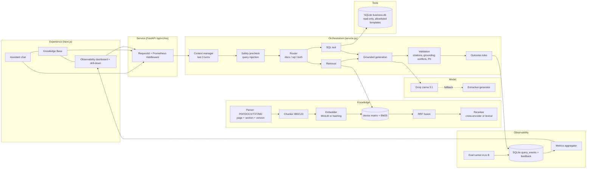

# Architecture & Design Decisions

## Overview

The production path from the original repository (PostgreSQL + pgvector + tsvector, MinIO, worker queue, Google OAuth, multi-tenant RLS) is untouched and runs when `DEMO_MODE=false`. Demo mode reuses its pieces: the app factory, config system, exception envelope, `RecursiveTextChunker`, `SentenceTransformerEmbedder`, `_reciprocal_rank_fusion`, structlog and the Prometheus middleware.

## Design decisions

### Model
- **Groq `llama-3.1-8b-instant`** is the generator. It is fast, cheap, and was already integrated in the repo. Temperature is 0 and output is capped at 600 tokens.
- The system prompt (template `kis-grounded-v1`) requires a source tag on every sentence and an exact insufficient-evidence phrase. It treats `<evidence>` and `<tool_result>` blocks as **untrusted data**.
- **Extractive fallback**: if no key is set or the call fails, the answer is built from the top reranked sentences, with citations. It is deterministic, which makes it suitable for tests and offline demos. It is always reported as `LLM_FALLBACK`.

### Chunking
- Text is split **per page (PDF) or section (headings)** first, then with the existing `RecursiveTextChunker` at **800 chars with 120 overlap**, so every chunk keeps an exact page or section for citation.
- Each chunk's index text is prefixed with `title (Doc-ID) version status | section`. That way, version and status words ("superseded") and IDs are searchable.
- Re-uploading identical content is detected by SHA-256 and is a no-op, so indexing is repeatable.

### Retrieval
- **Config A**: dense cosine only. **Config B**: dense + **BM25** (k1 = 1.5, b = 0.75, a custom ~40-line implementation, no new dependency), fused with **RRF k = 60** (the repository's own function), then **reranked**.
- The tokenizer keeps hyphenated IDs (`ACR-2291`, `PRJ-1002`) as single tokens, so exact-ID questions work even when semantic similarity is weak.
- **Evidence sufficiency** is the max of these signals: query-term coverage, cross-encoder probability (B), and cosine similarity (semantic embedder only). It is checked against `KIS_MIN_EVIDENCE_SCORE = 0.6`. Below that, the generator is not called and the answer is an honest fallback.

### Tools
- Routing is **rule-based** (regex signals are recorded in the trace), so the decision is explainable.
- The SQL tool uses only **allowlisted, parameterised templates** on a **read-only** SQLite connection. Parameters are extracted with strict patterns (`PRJ-\d{4}`) or matched against an allowlist (departments). User text never becomes SQL.
- Tool results are cited as `[T1]`, with provenance: template, sanitized params, row count and latency.

### Security
- **Query injection** is blocked before retrieval (`INJECTION_BLOCKED`).
- **Embedded injection**: instruction-like sentences are stripped from evidence before prompting, and the chunk is still used as data. Each one is logged with its patterns and the removed text.
- **PII redaction** (email, phone, ID/card patterns) is applied to the output.
- Errors are sanitized (exception class + truncated message, with paths removed) before being stored.
- Demo mode exposes no auth. It is visibly labelled and never enabled silently in production (`DEMO_MODE=false` mounts the original authenticated routers).

### Observability
- One **query event** per request covers all brief §8.2 categories (see [query_event_schema.md](query_event_schema.md)). It is stored as JSON plus indexed columns in SQLite.
- **Execution success is separate from quality outcome.** HTTP 200 is counted independently of Success / Partial / Failed.
- KPIs are computed from stored events only, and filterable by configuration, outcome, time window and eval runs.
- Evaluation runs are ordinary queries tagged with `eval.run_id`. Every eval case can be drilled into like a user query.
