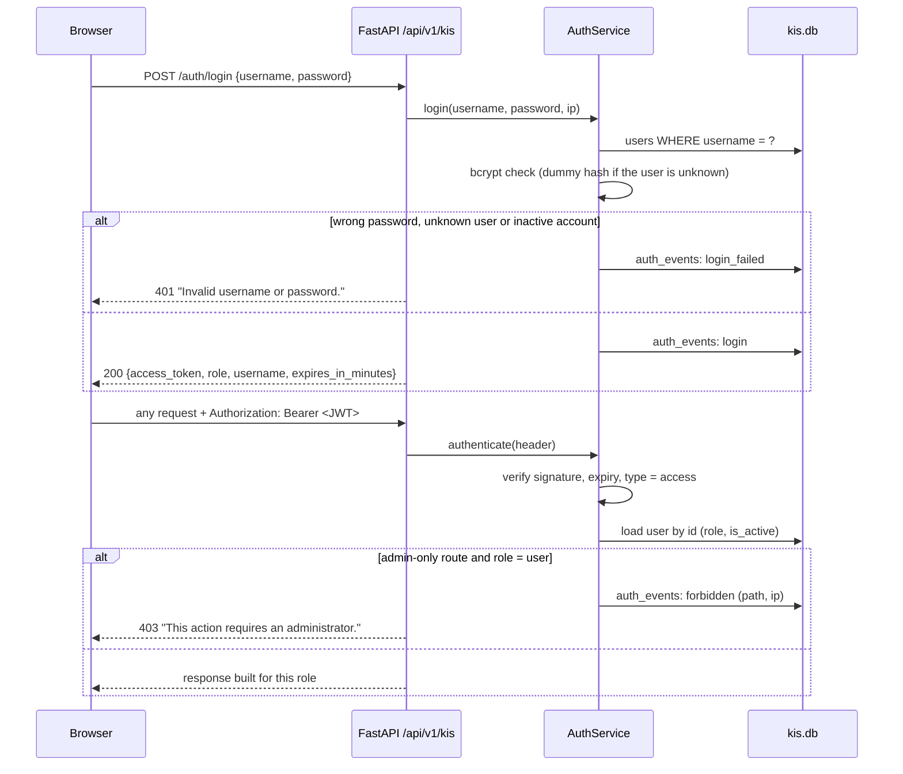

# Backend Authentication and Authorization

How sign-in, tokens and roles work in the knowledge service (local demo mode, `DEMO_MODE=true`). The original production path (`DEMO_MODE=false`: Google OAuth, organizations, PostgreSQL row-level security) is separate and not covered here; see [README.original.md](../README.original.md).

| | |
|---|---|
| Code | [`src/knowledge/auth.py`](../src/knowledge/auth.py) (logic), [`src/knowledge/routes.py`](../src/knowledge/routes.py) (dependencies and endpoints), [`src/core/security.py`](../src/core/security.py) (bcrypt and JWT helpers, reused from the base platform), [`src/knowledge/store.py`](../src/knowledge/store.py) (tables) |
| Tests | [`tests_knowledge/test_auth.py`](../tests_knowledge/test_auth.py), plus role checks in `test_users_activity.py` and `test_masking.py` |

## 1. Overview

- Two roles: **`user`** (the assistant, their own history) and **`admin`** (everything, including the knowledge base, observability, evaluation and user management).
- Users sign in with a **username and password**. The password is checked against a **bcrypt** hash; on success the API returns a signed **JWT** (HS256).
- Every endpoint except login and health requires `Authorization: Bearer <token>`.
- The token only says *who* the user is. The **role is read from the database on every request**, so changing a role or deactivating an account takes effect immediately.
- All checks run in the backend. The frontend hides admin pages too, but that is only convenience: a user who calls an admin endpoint directly gets **403**, and the attempt is logged.



## 2. Data

Tables in `data/kis.db`, created or migrated on start-up:

| Table | Columns | Purpose |
|---|---|---|
| `users` | `id` (UUID), `username` (unique, lower-case), `password_hash` (bcrypt), `role` (`admin` or `user`, enforced by a CHECK constraint), `is_active`, `created_at` | Accounts |
| `sessions` | `session_id`, `user_id`, `created_at`, `last_active_at`, `query_count` | Each conversation belongs to one user |
| `auth_events` | `username`, `user_id`, `event` (`login`, `login_failed`, `forbidden`), `success`, `ip`, `detail` (path for 403s), `ts` | Audit trail and input for unusual-activity rules |

The password hash is only read inside `AuthService.login` (`store.get_user_credentials`). Every other read uses `USER_PUBLIC_FIELDS` (`id, username, role, is_active, created_at`), and the API response models (`UserInfo`, `LoginResponse`) have no password field.

## 3. Accounts

**Demo accounts** are created by `python scripts/seed_demo.py` (`AuthService.ensure_demo_users`) if they do not exist yet:

| Username | Password | Role |
|---|---|---|
| `admin` | `admin123` | admin |
| `alice` | `user123` | user |
| `bob` | `user123` | user |

These passwords are public (they are in the code and README). Change them, or do not expose the app, outside a local demo.

**Creating users:** an admin calls `POST /api/v1/kis/admin/users` (or uses the Users page):

```json
{ "username": "carol", "password": "carol123", "role": "user" }
```

Rules (`AuthService.create_user`):
- the username is lower-cased and may contain only letters, digits, `.` and `_` (3–64 characters);
- the password needs at least 6 characters (max 128);
- the role must be `admin` or `user`;
- an existing username returns **409 Conflict**;
- the password is stored as a bcrypt hash with 12 rounds.

## 4. Login

`POST /api/v1/kis/auth/login` (public)

```json
{ "username": "admin", "password": "admin123" }
```

Response `200`:

```json
{
  "access_token": "eyJhbGciOiJIUzI1NiIs...",
  "token_type": "bearer",
  "username": "admin",
  "role": "admin",
  "expires_in_minutes": 480
}
```

Behaviour:
- The username is trimmed and lower-cased, so `Alice` works.
- **Unknown user, wrong password and inactive account all return the same `401 "Invalid username or password."`**, so the response does not reveal which usernames exist. For an unknown username, the password is still checked against a dummy bcrypt hash, so the response takes about as long as for a real account.
- Every attempt is written to `auth_events` with the client IP (`login` or `login_failed`).
- The bcrypt check runs in a worker thread, so it does not block other requests.

## 5. The token

Created by `create_access_token` in `src/core/security.py`:

| Claim | Value |
|---|---|
| `sub` | user ID (UUID) |
| `email` | the username (the claim name comes from the base platform) |
| `iat` / `exp` | issued at / expiry |
| `type` | `access` |

- **Algorithm:** HS256 (`JWT_ALGORITHM`).
- **Lifetime:** `KIS_TOKEN_EXPIRE_MINUTES`, default **480 minutes** (8 hours).
- **Secret:** `JWT_SECRET_KEY` from `.env`. If it is missing or still the placeholder from `.env.example`, the service generates a **random secret per process** and logs a warning. Tokens then cannot be forged with a known value, but everyone is signed out whenever the backend restarts. Set a real value:

  ```bash
  python -c "import secrets; print(secrets.token_hex(32))"
  ```

The role is deliberately **not** trusted from the token; it is looked up on each request (section 6).

## 6. Checking each request

Two FastAPI dependencies in `routes.py` protect the endpoints:

```python
def current_user(request, svc) -> CurrentUser:
    # Any signed-in, active user (401 otherwise)
    return svc.auth.authenticate(request.headers.get("Authorization"))

def admin_user(request, user=Depends(current_user), svc) -> CurrentUser:
    # An admin (403 and a logged "forbidden" auth event otherwise)
    svc.auth.require_admin(user, request.url.path, client_ip)
    return user
```

`AuthService.authenticate` returns **401** when:
- the header is missing or does not start with `Bearer ` → "Sign in to continue.";
- the signature is invalid or the token was tampered with → "Invalid access token.";
- the token has expired → "Access token has expired.";
- the token type is not `access`, or claims are missing;
- the user no longer exists or `is_active` is false → "This account is not active."

Otherwise it loads the user from the database and returns `CurrentUser(id, username, role)`.

`AuthService.require_admin` lets admins through. For anyone else it records a `forbidden` auth event (username, user ID, IP and the path requested) and returns **403** "This action requires an administrator."

Errors use the shared envelope:

```json
{ "error": { "code": "AUTHENTICATION_FAILED", "message": "Invalid username or password." } }
```

(`FORBIDDEN` for 403.)

## 7. Who can call what

All paths are under `/api/v1/kis` unless noted.

| Access | Endpoints |
|---|---|
| **Public** | `POST /auth/login`; `GET /health`, `GET /health/ready` (outside `/api/v1`) |
| **Any signed-in user** | `GET /auth/me`, `GET /config`, `POST /query`, `POST /query/multimodal`, `POST /feedback`, `GET /assets/{id}`, `GET /my/sessions`, `GET /my/history` |
| **Admin only** | `POST /ingest`, `POST /ingest/demo`, `GET /documents`, `GET /documents/{id}/chunks`, `DELETE /documents/{id}`, `GET /metrics`, `GET /queries`, `GET /queries/{id}`, `POST /eval/run`, `GET /eval/status`, `GET /admin/users`, `POST /admin/users`, `GET /admin/users/summary`, `GET /admin/users/{id}/sessions`, `GET /admin/sessions/{id}`, `GET /admin/anomalies` |

A parametrized test (`test_user_gets_403_on_admin_routes`) calls every admin route with a user token and expects 403, and `test_anonymous_gets_401` expects 401 without a token.

## 8. Rules beyond the role check

These keep one user away from another user's data, even though both have the `user` role:

| Rule | Where | Result |
|---|---|---|
| A conversation (`session_id`) belongs to the user who started it | `KnowledgeService.query` (`store.session_owner`) | Another user reusing the ID gets **403** "This conversation belongs to another user." |
| Conversation memory is keyed by user and session | `ConversationMemory` key `"{user_id}:{session_id}"` | Follow-up context never crosses users |
| Feedback only on your own answers | `POST /feedback` | Someone else's query ID returns **404** (it does not reveal that it exists) |
| History only your own | `GET /my/history`, `/my/sessions` | Filtered by the caller's user ID |
| Personal data masked for users | `KnowledgeService._present`, [`masking.py`](../src/knowledge/masking.py) | Users see `[SALARY]`, `[EMAIL]`, etc.; admins see raw text; stored events stay raw |
| Every query records who asked | `query_events.user_id`, `username`, `role` | Per-user analytics and audit |
| Evaluation runs | `SYSTEM_EVAL_USER` (admin) and `EVAL_USER` (user) identities | Started only by admins; user-role cases exercise masking |

## 9. Monitoring

Auth events feed the unusual-activity rules in [`anomaly.py`](../src/knowledge/anomaly.py), shown on the Observability and Users pages:

| Rule | Fires when (defaults, configurable in `.env`) |
|---|---|
| `FAILED_LOGINS` | 5 or more failed logins for one username within 10 minutes (`KIS_ANOMALY_FAILED_LOGINS_10MIN`) |
| `FORBIDDEN_ACCESS` | 3 or more 403 responses for one user in 24 hours (`KIS_ANOMALY_FORBIDDEN_PER_24H`) |

The other rules (bursts, injection attempts, PII fishing, token spikes, off-hours use) use the user ID recorded on each query event.

## 10. Frontend side

For completeness, how the Next.js app uses this ([`frontend/src/lib/auth.tsx`](../frontend/src/lib/auth.tsx), [`frontend/src/lib/api.ts`](../frontend/src/lib/api.ts)):

- The login form posts to `/auth/login` and stores `access_token` in `localStorage`; `fetchApi` adds the `Authorization` header to every call.
- On start-up the app calls `/auth/me` to restore the session and learn the role.
- Any 401 (except a failed login) clears the token and returns to `/login`.
- `RequireAuth` redirects users away from admin pages. This only tidies the UI; the backend enforces the rules above.

## 11. Configuration

| Variable | Default | Meaning |
|---|---|---|
| `JWT_SECRET_KEY` | placeholder → random per process | HS256 signing key; set it so logins survive restarts |
| `JWT_ALGORITHM` | `HS256` | JWT algorithm |
| `KIS_TOKEN_EXPIRE_MINUTES` | `480` | Token lifetime in demo mode |
| `KIS_ANOMALY_FAILED_LOGINS_10MIN` | `5` | Failed-login threshold |
| `KIS_ANOMALY_FORBIDDEN_PER_24H` | `3` | 403 threshold |

## 12. Known limitations

| Limitation | Effect | Possible next step |
|---|---|---|
| No refresh tokens and no server-side logout | Signing out deletes the token in the browser; a copied token stays valid until it expires (8 h) | Short-lived tokens with refresh, or a token deny-list |
| Token in `localStorage` | Readable by any script on the page if an XSS bug existed | httpOnly, SameSite cookie |
| No lock-out or rate limit on login | Repeated failures are detected (`FAILED_LOGINS`) but not blocked | Rate-limit `/auth/login` per username and IP |
| No API to change passwords, change roles or deactivate users | `is_active` and `role` are honoured but can only be changed in the database | Admin endpoints for these |
| Demo passwords are public | Anyone who can reach the app can sign in as admin | Set passwords from secrets before exposing the app |
| Single shared secret, no key rotation | Rotating `JWT_SECRET_KEY` signs everyone out | Key IDs (`kid`) with overlapping keys |
